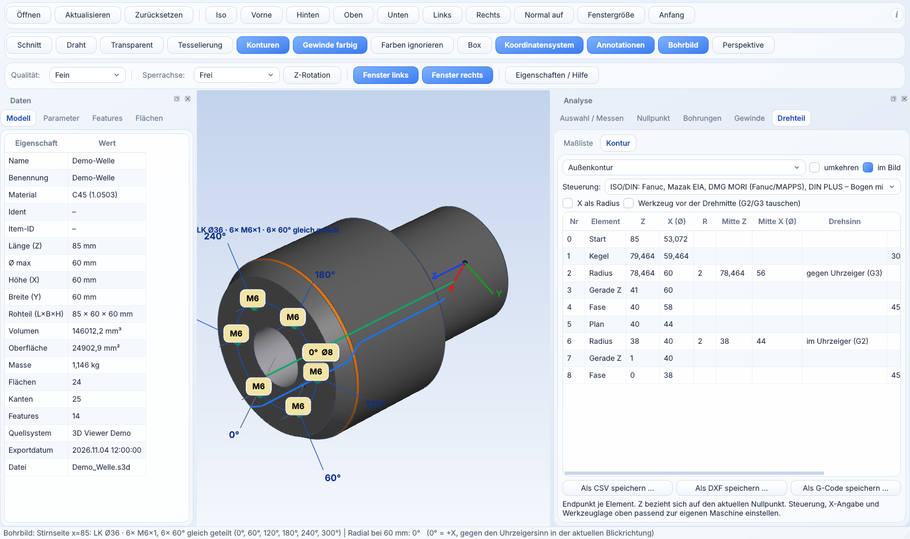

<p align="center"></p>

# 3D Viewer

Kostenloser 3D-Viewer zum **Ansehen und Ausmessen von Bauteilen** aus `.s3d`-Dateien.
Gedacht für alle, die schnell ein Maß brauchen, das in der Zeichnung fehlt:
Durchmesser, Abstände, Winkel, Radien, Bohrbilder und Gewindetiefen.



---

## In 3 Schritten starten (ohne Installation)

1. **Herunterladen:** Rechts auf dieser Seite auf **„Releases“** klicken und dort
   **`3D_Viewer.exe`** und **`Demo_Welle.s3d`** herunterladen.
2. **Starten:** `3D_Viewer.exe` doppelklicken.
   Falls Windows *„Der Computer wurde durch Windows geschützt“* meldet:
   auf **„Weitere Informationen“** und dann **„Trotzdem ausführen“** klicken.
   (Das kommt bei neuen Programmen häufig vor.)
3. **Ausprobieren:** Die Datei `Demo_Welle.s3d` einfach ins Programmfenster ziehen
   – oder oben links **„Öffnen“** klicken.

Läuft unter Windows 10 und 11. Es wird nichts installiert, nichts ins Internet gesendet.

---

## Die wichtigsten Handgriffe

| Was | Wie |
|---|---|
| Drehen | linke Maustaste ziehen |
| Um die Mittelachse drehen | **Alt + Mausrad** |
| Verschieben | rechte Maustaste ziehen |
| Zoomen | Mausrad (feiner: **Umschalt** + Mausrad) |
| Fläche/Kante wählen | anklicken (wird rot), nochmal anklicken = abwählen |
| **Maß zwischen zwei Elementen** | beide nacheinander anklicken – das Maß erscheint sofort |
| Alles abwählen | **Esc** |
| **Alles auf Anfang** (verstellt?) | Knopf **Zurücksetzen** oder **Strg+R** |
| **Hilfe** mit allen Befehlen | **F1** oder Knopf **Eigenschaften / Hilfe** |
| Ansicht von vorne / oben / links | **F** / **T** / **L** |
| Ganzes Teil zeigen | **W** |
| Schnitt durchs Teil | **S** – verschieben: Pfeiltasten oder Umschalt + Mausrad |
| Schnitt kippen | **Strg + Umschalt + Mausrad** oder Strg + Pfeiltasten |
| Nur Linien | **Y** |
| Durchsichtig | **G** |
| Bohrbild mit Winkeln | **Strg+B** |
| Gewinde farbig ein/aus | **Strg+G** |
| Bedienoberfläche größer/kleiner | **AltGr + Mausrad** oder Strg+Plus / Strg+Minus |

Rechtsklick (ohne Ziehen) öffnet ein Menü mit allen Funktionen. Die Tastenkürzel jedes Knopfs
zeigt der Tooltip, wenn man die Maus kurz darauf hält.

## Was das Programm kann

- **Messen:** Durchmesser, Wandstärke, Abstand, Achsabstand, Fasen- und Kegelwinkel
- **Maßliste des Drehteils:** alle Ø, Planflächen, Fasen, Radien mit Z-Lage – als CSV
- **Drehkontur** als Elementliste (Z, X als Ø oder Radius, Radien mit Mittelpunkt, G2/G3) – als CSV, DXF
  oder G-Code-Kontur für ISO/DIN-Steuerungen (Fanuc, Mazak, DMG MORI …) und Siemens 840D
- **Radius-Mittelpunkt** für die Drehmaschine (Z und X als Durchmesser)
- **Radius oder Fase „wegdenken“:** scharfe Ecke mit exaktem Z-Wert anzeigen
- **Bohrbild:** Lochkreis, Teilung und Winkel jeder Bohrung, C0° frei wählbar
- **Gewindebohrungen:** Gewindebereich farbig im Bauteil, Gewindetiefe, Kernloch-Ø, Kernlochtiefe, Bohrspitze
- **Eigener Nullpunkt** (z. B. Teilmitte, Planfläche) und Bohrungstabelle als CSV
- Schnittansicht, Glas-Ansicht, Linien-Ansicht, Box mit Außenmaßen

Ausführliche Beschreibung aller Funktionen: [LIESMICH.txt](LIESMICH.txt)

---

## Für Entwickler

Python 3.10+:

```
pip install -r requirements.txt
python S3D_Viewer.pyw
```

Eigene EXE bauen: `build.bat` (PyInstaller).

## Urheber und Lizenz

© 2026 Christian Diezinger – [github.com/Rabenstaub](https://github.com/Rabenstaub)

Freie Software unter der [MIT-Lizenz](LICENSE): Nutzen, Weitergeben und Ändern erlaubt,
der Urheberhinweis muss erhalten bleiben. Ohne Gewähr – Maße für die Fertigung bitte
immer mit der gültigen Zeichnung abgleichen.

Die Demo-Datei `demo/Demo_Welle.s3d` ist frei erfunden und darf beliebig verwendet werden
(Drehkontur mit Fasen/Radien/Kegel, 6× M6, Querbohrung, Passfedernut, Schlüsselfläche,
Schrägbohrungen 45°). Erzeugt wird sie mit `demo/generator/make_demo.py`.
`demo/Demo_Indexbolzen.s3d` (Spitze R5 / 30° / 15°, 4× Ø3 unter 45° in Bohrung Ø5) zeigt die
roten Bohrungs-Eintrittspunkte; Erzeuger: `demo/generator/make_indexbolzen.py`.
Das Logo liegt im Ordner `logo/` (SVG, PNG, ICO).
